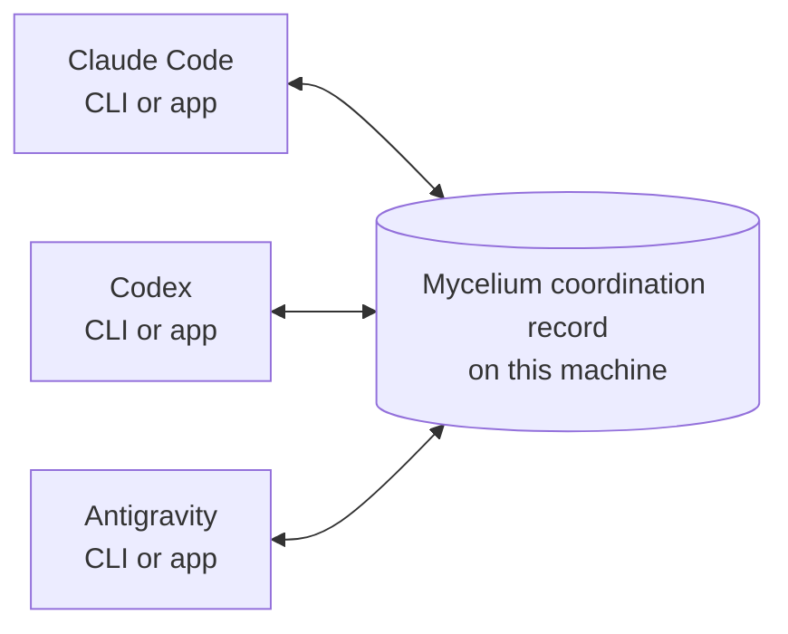
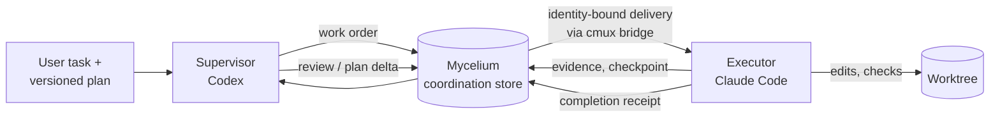

# SporeDrive

SporeDrive connects **Claude Code, Codex and Antigravity** through
**[Mycelium](https://github.com/arjunrajlaboratory/mycelium)** so they can work with each other
directly. Each host can take part from its CLI or its desktop app. A session in any of them can:

- ask another for a second opinion or a review;
- send a question or a report to one specific session;
- keep an ongoing, linked conversation with one partner session;
- find which sessions are live and which task each one is bound to.

Messages go through Mycelium's coordination record on disk instead of copy-paste between chat
windows. A message can be addressed to one specific session. It survives compaction and restarts,
and can be checked later.



**How it relates to Mycelium.** Mycelium is a plugin that gives each project a memory: decisions,
learnings and handoffs kept in its `.living/` folder. SporeDrive is the home of Mycelium's
coordination layer, `mycelium-coord`: the shared record, its CLI and its MCP tools.

- Setup builds one Mycelium plugin with this layer included. Claude Code and Codex load it as part
  of Mycelium, not as a second plugin.
- Antigravity connects to the same coordination server through its own MCP settings.
- The coordination works with or without Mycelium's project-memory hooks.

**No host is in charge.** A session joins a task under a label: supervisor, executor or observer.
No app has a fixed role: a session in any of the three can take any label, and any session on a
task can message any other session on it. The labels are chosen per task. Two limits apply:

- **An executor works in one worktree.** The executor label is tied to the task's worktree.
  Keeping that session the only writer is a workflow policy backed by each host's own permissions;
  SporeDrive does not enforce it at the filesystem level.
- **A stored message wakes nobody by itself.** Each host is reached in its own way, described
  [below](#how-the-three-hosts-connect).

SporeDrive also ships one ready-made way to use these connections: **supervised work**, where one
session directs, one session writes, and dispatches and reviews have limits. It is optional; see
[Optional workflow: supervised work](#optional-workflow-supervised-work).

It is aimed at people who already run Codex and Claude Code, and optionally Antigravity, on a Mac.
They want work across these hosts to be:

- **addressable**: a message reaches one specific session;
- **resumable**: the task survives compaction and restarts;
- **auditable**: "done" means evidence was checked, not merely claimed;
- **bounded, when they choose**: a managed task limits dispatches and reviews.

SporeDrive coordinates the models; it does not make them reason better. It makes no promise of
cost savings or reliability.

## How the three hosts connect

Any of the three hosts can ask another for a second opinion, a review or a report. Each piece is
switched on in its own place:

- **Per task (opt-in):** the extra message kinds (`triangle-kinds`), headless Codex wake
  (`codex-exec-wake`), send capability (`send-capability`) and link mode (`session-links`). A task
  created without them behaves as before.
- **Per process (optional):** restricted mode.
- **Per host, once installed:** the stale-write guard.
- **No task needed:** call mode is a CLI command.

| Host | Labels it can join a task with | Reviews | How an idle session is reached |
|---|---|---|---|
| Claude Code | supervisor, executor or observer | gives them through call mode or review messages | the cmux bridge types into the one bound session |
| Codex | supervisor, executor or observer | gives them through call mode or review messages | `codex exec resume` on the stored thread, only on tasks with `codex-exec-wake` and a participant attached with `wake=headless` |
| Antigravity | supervisor, executor or observer | gives them through call mode or review messages | no wake route; it reads its inbox on its next turn |

Sessions find each other through the same record:

- `list-sessions` lists one host's sessions, the task each is bound to, and whether it is still
  live.
- `find-recipients` lists the participants a sender can address on a task, filtered by label or
  host.
- `status-read` reads the status published for a session, such as its runtime state and current
  task.
- A notification can carry a short `sd:` handle that resolves to the full message.

Each also has an MCP tool. There are two ways to talk:

- **Call mode (one-off, headless).** `mycelium-coord consult call --target codex|claude|antigravity`
  starts a brand-new session of the target.
  - The session gets one written packet, answers once and is discarded.
  - It is read-only. For Antigravity this is enforced only at its permission prompt.
  - Every call reports one outcome: `ANSWERED`, `NOT_STARTED`, `REFUSED`, `UNAVAILABLE` or
    `TIMED_OUT`.
  - Once a call directory exists, a receipt records the outcome. It also records which named files
    the session was seen to read (a heuristic) and flags any change to those files or to host
    config.
  - The answer can be posted back to a task as a report.
- **Link mode (ongoing collaboration).** One session proposes a link and the partner confirms it.
  Both are pinned to their native session ids.
  - A linked send or wake is addressed only to the pinned partner. The task record itself stays
    shared.
  - A link goes stale, and never retargets, when a member detaches or a different session takes
    the participant.

Three safeguards back these modes:

- **Restricted mode (optional).** It is called advisory containment in the code and in FEATURES.md.
  It applies to a coordination process started with `MYCELIUM_COORD_ADVISORY=1`. It is a switch on
  one connection, not a role for an app:
  - Call mode starts every called session this way, whichever app it is.
  - Any app's connection can also be started this way, for example for scripted runs that should
    not drive work.

  A restricted process is limited to the following.
  - **It may:**
    - read;
    - create an unmanaged task;
    - attach as an observer;
    - as that observer, send non-actionable messages: questions, progress, review findings,
      acknowledgments, consult requests and reports;
    - acknowledge messages, move its cursor and detach;
    - confirm or end a link it was invited to.
  - **The core refuses** every authority or drive operation, whatever route calls it:
    - other roles and actionable sends;
    - checkpoint publish and execution changes;
    - wakes and bridge notifications;
    - job, worker and consult launches.
  - Its MCP server also hides the tools outside its allowlist, where FastMCP allows it.
- **Send capability.** Every identity-bearing write is accepted only from the process that holds
  that participant's capability: sends, acknowledgments, cursor moves, checkpoint publishes,
  detaches, wakes, bridge notifications and link changes.
  - The capability is minted at attach. The CLI keeps it in a `--cap-file`.
  - It applies on tasks with `send-capability` and always in a restricted process.
  - Link mode requires it.
- **Stale-write guard** (`writeguard.py`, a hook for all three hosts). It refuses a tool-based
  whole-file write over a file the session has not read, or that changed since it last read it.
  The session re-reads and retries.
  - On Codex it checks `apply_patch` Add File and Move to an existing path. On Antigravity it checks
    the write-file tools. On Claude Code it refuses nothing, because Claude Code already refuses
    stale edits itself.
  - It never refuses a shell overwrite on any host. Claude Code and Codex get a warning, and
    Antigravity logs one.
  - It never refuses appends.
  - It was checked against the hooks and skills of Mycelium 0.9.3 to 0.9.7. The details and known
    limits are in
    [WRITE_GUARD_SPEC.md](docs/triangle/WRITE_GUARD_SPEC.md#running-alongside-mycelium-compat-pass-2026-11-24).

Full reference: [docs/triangle/FEATURES.md](docs/triangle/FEATURES.md).

## Components

| Component | Where | What it does |
|---|---|---|
| Instruction and skill policy | `src/claude/`, `src/codex/` | Global instruction files (`CLAUDE.md`, `AGENTS.md`), the Claude `codex-review` skill and `codex_ask` reviewer wrapper, and the Codex `cmux-driver` skill (driver protocol, runbook, plan template). |
| Mycelium coordination | `coordination/mycelium_coord/` | Store for tasks, messages, checkpoints, session discovery and status, and execution allowances. Exposed as a CLI (`coordination/bin/mycelium-coord`) and `coord_*` / `execution_*` MCP tools. |
| Triangle features | `coordination/mycelium_coord/` (`consult.py`, `links.py`, `sendcap.py`, `wake.py`) | Call mode, link mode, send capability and the per-host wake routes. Advisory containment lives in the core (`model.py`) and the MCP allowlist (`mcp_server.py`). |
| Call-mode adapters | `src/consult/` | One headless launcher per host, each restricted to reading: `codex_call.sh`, `claude_ask.sh`, `agy_ask.py`. |
| Stale-write guard | `coordination/mycelium_coord/writeguard.py`, `docs/triangle/proposed/writeguard-hooks/` | A standalone hook script and per-host registration templates. Setup does not install it. |
| cmux bridge | `bridge/cmux_bridge/` | A `codex-claude-bridge` MCP server. It binds to one Claude session in the cmux terminal app, then submits notifications into it. Before each Enter keypress it re-checks the task's pause and closure gate. |
| Lifecycle hooks | `mycelium-source/` plus `core-overlay/` | Bundled Mycelium plugin source. Its SessionStart, PostToolUse and Stop hooks keep optional "living repository" bookkeeping (`.living/` logs, learnings, handoffs). The overlay replaces whole core hook files and is written for Mycelium 0.6.0, the bundled source's release. |
| Installer and exporter | `scripts/wfctl.py`, `scripts/export_coordination.py` | `wfctl` installs the global instruction files and skills, with snapshots and rollback. The exporter builds one integrated plugin from a Mycelium source plus the coordination package. It refuses to apply the overlay to any Mycelium release other than 0.6.0. |

State is split between your machine and the model services:

- **On your machine:** the coordination store (a directory chosen by `--root` or
  `MYCELIUM_COORD_DIR`), install snapshots, and each project's `.living/` and `.mycelium/`
  bookkeeping.
- **External:** only model inference, by the Codex, Claude Code and (if used) Antigravity services
  you already use.

Three layers are independent:

- **The coordination protocol** (messages, checkpoints, allowances) works with or without the
  lifecycle hooks.
- **Living-repository bookkeeping** applies only to projects you initialize.
- **Host activation** (plugin install, hook trust, restarts) decides what a fresh session actually
  loads.

## Optional workflow: supervised work

One way to use these connections is supervised work. One session directs, and one executor session
is the only writer of a repository worktree. On a managed task, dispatches and reviews draw on fixed
allowances, and the task closes only when its required checks have passed. The shipped instruction files and the cmux bridge are built
around Codex directing and Claude Code executing.

Consults, reviews, reports and linked conversations do not need this workflow.

### The problem it addresses

Directing one agent with another usually fails in a few predictable ways:

- instructions typed into the wrong window;
- a supervisor that quietly starts editing too;
- context lost at compaction;
- review loops that never end;
- "done" reported without evidence.

SporeDrive answers each of these with a small, explicit mechanism:

- a single-writer role split;
- a persisted, addressed message store;
- delivery bound to one native session identity;
- per-task allowances enforced in code for managed tasks;
- completion receipts that are verified against artifact hashes.

### How a piece of work flows



1. The user gives a task. For substantial work, it comes with a versioned plan.
2. The supervisor writes a **work order**: scope, fixed checks and the evidence required.
3. The work order is **stored** as an addressed coordination message.
4. The supervisor **delivers** it through the cmux bridge. The bridge types into the one session
   that matches the bound workspace, worktree, session id and controller.
5. The executor does the work, runs the checks, and reports **evidence** and **checkpoints**.
6. At milestones, the supervisor reviews and relays a plan delta or repair order. Each review and
   repair is drawn from a fixed allowance.
7. The executor sends a **completion receipt** naming artifacts and their sha256.
   - A matching hash verifies the evidence's identity only.
   - The task closes only when its frozen required checks and criteria have passed and been
     accepted.

Five states are kept separate on purpose:

| State | What it means |
|---|---|
| Stored | The message is persisted in the store. It wakes nobody. |
| Submitted | The bridge typed it into the bound terminal session. |
| Accepted | The native host actually took it as input. |
| Evidence verified | A receipt's artifacts matched their recorded hashes. This proves which files were submitted. |
| Accepted complete | The frozen required checks and criteria passed and were accepted, so the task can close. |

A stored message does not wake an idle session. There is no background dispatcher, daemon or
scheduler.

### Role policy (project defaults)

The shipped instruction files configure these roles. They are this project's choices, not vendor
recommendations:

- **Substantial work:**
  - An Astra XHigh session and a dedicated Fable 5.1 planner produce a versioned plan.
  - A Sol 6 Medium session drives a dedicated Opus 5.5 executor through cmux.
  - At milestones backed by evidence, the driver asks for both an Astra correctness audit and
    Fable plan feedback, then relays one reconciled work order.
- **Fable is planning-only.** Implementation sessions start with an explicitly chosen model. The
  bridge refuses to bind implementation work to a Fable or default-model session
  (`bridge/cmux_bridge/model_policy.py`).
- **Routine, narrow work** needs no panel. It gets one scoped review and one verification of its
  repairs.

The limits of this policy:

- **Model availability:** these are role names in the instruction files. Check which models your
  installed Codex and Claude Code versions and accounts actually offer, and edit
  `src/` to match before installing.
- **Enforcement:** nothing here schedules reviewers automatically. The allowance machinery only
  refuses work beyond a task's limits.

Full contracts:
[implementation-plan template](src/codex/skills/cmux-driver/references/implementation-plan.md) and
[driver protocol](src/codex/skills/cmux-driver/references/driver-protocol.md).

### Example: one milestone

After setup, a user might hand the supervisor something like this:

```text
Task: add CSV export to the report CLI (plan v1.0, repo ~/src/reportkit).
Milestone 1 — export command
  Outcome:  `reportkit export --csv out.csv` writes all rows with a header.
  Checks:   pytest tests/test_export.py passes; ruff clean on changed files.
  Evidence: test log path, diff stat, sample out.csv with sha256.
  Hold:     do not start milestone 2 (streaming) until milestone 1 is reviewed.
Limits: one scoped review, one repair, deadline 17:00 Eastern.
Please open a managed task, launch an Opus executor in cmux, and send this as the work order.
```

The supervisor then does the following:

1. Opens a managed task with those limits.
2. Stores and delivers the work order to the bound executor.
3. Waits for evidence, and reviews once.
4. Relays at most one repair.
5. Checks that the receipt's files hash-match. It accepts completion only once the milestone's
   required checks have passed.

For a runnable, command-level walk-through of the underlying messages, see
[docs/operations.md](docs/operations.md#minimal-message-exchange).

## Prerequisites and platform

- macOS, with the cmux terminal app. The bridge needs cmux socket access, in
  either `cmuxOnly` ancestry or password socket-control mode.
- Current `codex` and `claude` CLIs, logged in.
- Python 3.13 (the tested interpreter) with `fastmcp` and `mcp` installed on the interpreter that
  runs the two MCP servers. For tested versions, see
  [docs/installation.md](docs/installation.md#tested-versions).
- Everything runs on one machine. The store is a local directory, not a network service.

## Setup in outline

Cloning installs nothing. Setup is four distinct steps; details and exact commands are in
**[docs/installation.md](docs/installation.md)**.

1. **Review and customize `src/`.** Then run `python3 scripts/wfctl.py install`. This *replaces*
   the managed global files under `~/.claude` and `~/.codex`, after snapshotting them.
   These files include the supervised-work role policy.
   - `wfctl.py verify` reports drift.
   - `wfctl.py rollback <label>` restores a snapshot, and it supports `--dry-run`.
   - `install` itself has no dry-run mode.
2. **Export the integrated plugin.** Run
   `python3 scripts/export_coordination.py --source mycelium-source --target <dir>`.
   Always pass `--source` explicitly.
   - The export applies `core-overlay/` by default, and the overlay fits only Mycelium 0.6.0.
   - To build on a newer Mycelium source, add `--no-overlay`. Without it, the exporter refuses
     and leaves the target untouched.
   - Coordination does not need the overlay.
3. **Activate it on each host** from the local export directory:
   - Claude: install the plugin from the local marketplace.
   - Codex: install the plugin, then trust all seven hook registrations in `/hooks`.
   - Restart, because only fresh sessions load the new build.
   - Register the cmux bridge separately for Codex.
4. **Initialize each target repository** as a Mycelium project. On Claude Code, this is what
   registers the lifecycle hooks for that repository.

Two optional steps are manual, and the installer does neither:

- **Connecting Antigravity.** Register the coordination MCP server with Antigravity
  (`agy mcp add`). It then takes part like the other two apps. Add `MYCELIUM_COORD_ADVISORY=1` to
  the server's environment only if you want its connection restricted.
  - `agy mcp add` writes `~/.gemini/config/mcp_config.json`, which the CLI and the desktop app
    both read. It therefore applies to every Antigravity run on the machine, including scripted
    `agy -p` runs.
  - Headless `agy -p` runs also need explicit `mcp(<server>/<tool>)` permission grants. Without
    them the CLI auto-denies the tools, exits 0 and does nothing.
  - Only the restricted setup has been tried, and only on scratch stores.
- **The stale-write guard.** Copy the matching template from
  `docs/triangle/proposed/writeguard-hooks/` into each host's hook configuration.
  - Replace `<ABS_PYTHON>` and `<ABS_PATH_TO>` with real absolute paths.
  - On Antigravity the template goes in a workspace's `.agents/hooks.json`. Antigravity blocks a
    tool call when its hook cannot run, so a wrong path blocks the matched tools.
  - On Codex, append its hook groups after the existing ones. Codex keys hook trust by position,
    so inserting groups disturbs existing approvals.
  - The `MYCELIUM_WRITE_GUARD` variable sets the mode: `off`, `warn` or `enforce`.

## Limits and maturity

This is a working personal toolchain published as-is. It is not a production service.

- **What is enforced, and what relies on trust.** Allowances, reservations, and pause, expiry and
  closure gates are enforced in code for *managed* tasks.
  - Whether a message is actionable is a disposition the sending agent declares honestly.
  - Unmanaged messaging is not gated.
  - File and shell access still depend on each host's own permission settings.
- **No overall model, token or cost cap.** SporeDrive limits dispatches, reviews and the reviewer's
  wall-clock time. It does not cap what a session spends while reasoning.
- **Same machine only.** Sessions share a local store directory.
- **No unattended operation.** There is no scheduler. A stored message does not wake an idle
  session.
  - Waking an idle Codex desktop session is experimental and reports `not_established`.
- **The installed build must be exact.** Installing or re-exporting affects only fresh sessions.
  Check what a session actually loaded before trusting it; see the health checks in
  [docs/installation.md](docs/installation.md#health-checks).
- **The triangle: containment, not authentication.**
  - Restricted mode and send capability stop a restricted process from driving work through the
    coordination tools. They do not authenticate who a session is.
  - Restriction depends on the server's environment variable, not on which host is calling.
  - The store is plain files owned by your user. An agent with shell access can get around
    restriction by running the CLI without the variable or by editing the store.
  - In call mode, a Codex or Antigravity target can read any file your user account can read.
    Only Claude is confined to its folder.
  - On the Claude bridge route, a rebind just before the send can deliver a linked message to the
    new session; see FEATURES.md.
  - The record of which files a call read is a heuristic. When unsure, it reports no value plus a
    lower bound.
- **Stale-write guard limits.**
  - It is not installed by setup.
  - Shell overwrites are only warned about or logged.
  - Never run live:
    - the Antigravity IDE and desktop app routes;
    - the Claude Code shell-warning hook;
    - Codex hook ordering when one hook denies.
  - With Mycelium 0.9.7 or later on Codex, a refused `apply_patch` leaves Mycelium's file-change
    records in that repository marked "shared" rather than credited to one action for up to a
    day. The changes are still recorded.

## Repository map

```
src/claude/, src/codex/     instruction files and skills installed by wfctl
src/consult/                call-mode adapters for Codex, Claude Code and Antigravity
coordination/               mycelium_coord package (incl. triangle features and write guard),
                            CLI launcher, coordination skill, tests
bridge/                     cmux_bridge MCP server and its offline tests
mycelium-source/            bundled Mycelium lifecycle plugin source (0.6.0; pinned; own LICENSE)
core-overlay/               repo-owned hook files that replace source hooks at export (0.6.0 only)
scripts/                    wfctl.py, export_coordination.py, smoke_check.sh, script tests
tests/                      installer tests
docs/                       installation and operations guides
docs/triangle/              triangle features, two-modes design, write-guard spec and the
                            write-guard hook templates (proposed/)
PROVENANCE.md, VERSION      source provenance and the instruction-contract version
```

## Contributing and offline checks

All of these run offline, with no cmux, network or model calls:

```bash
python3 -m pytest tests -q                                   # installer
( cd bridge && python3 -m pytest tests -q )                  # bridge
( cd coordination && python3 -m pytest tests -q )            # coordination package
python3 -m pytest -q scripts                                 # exporter and script tests
```

The coordination tests include the triangle features, the write guard and the call-mode adapters,
which run against fake hosts.

Two other checks touch real sessions and are not routine tests:

- `scripts/smoke_check.sh` runs fresh `claude -p` and `codex exec` instruction smokes, so it makes
  model calls.
- The live bridge acceptance run (`bridge/run_live.sh`) needs a real cmux session and a disposable
  directory.

Run both only deliberately.

## Provenance and license

- **MIT:** the SporeDrive-authored parts (`src/`, `coordination/`, `bridge/`, `scripts/`, `tests/`,
  docs) are MIT-licensed; see [LICENSE](LICENSE).
- **Derived from Mycelium:** `core-overlay/` holds modified copies of Mycelium 0.6.0 hook files,
  which remain under Mycelium's own license.
- **Upstream Mycelium:** `mycelium-source/` is Mycelium lifecycle source pinned at commit
  `f2b0083`. It carries its own upstream `LICENSE` (MIT, Mycelium Contributors) and `README.md`.
- **History:** [PROVENANCE.md](PROVENANCE.md) records what was included or excluded and why.

## Further reading

- [docs/installation.md](docs/installation.md): install, export, activation, health checks, bridge
  setup, rollback.
- [docs/operations.md](docs/operations.md): bounded execution, waiting, owner follow-up, messaging
  example, troubleshooting.
- [cmux runbook](src/codex/skills/cmux-driver/references/cmux-runbook.md) and
  [bridge MCP contract](src/codex/skills/cmux-driver/references/bridge-mcp.md).
- [Mycelium coordination reference](src/codex/skills/cmux-driver/references/mycelium-coordination.md)
  and [coordination skill](coordination/skill/SKILL.md).
- [docs/triangle/FEATURES.md](docs/triangle/FEATURES.md): advisory containment, wake routes, send
  capability, call mode and link mode, with every refusal code.
- [docs/triangle/TWO-MODES-DESIGN.md](docs/triangle/TWO-MODES-DESIGN.md): why there are two modes.
- [docs/triangle/WRITE_GUARD_SPEC.md](docs/triangle/WRITE_GUARD_SPEC.md): the stale-write guard,
  per-host facts, and how it runs alongside Mycelium.
- [src/consult/README.md](src/consult/README.md): the call-mode adapters, exit codes and receipts.
